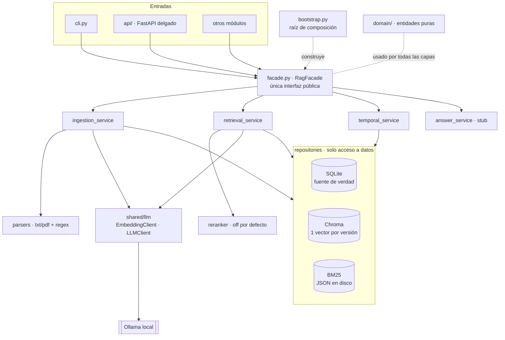

# Hackaton NTTDATA — RAG temporal sobre normativa SBS

Monorepo modular, 100 % local (Ollama, sin APIs externas). Este repo contiene, por ahora, el módulo **`rag`**: búsqueda sobre normativa bancaria peruana (SBS) que

- **cita la fuente exacta** (norma, artículo, versión, intervalo de vigencia);
- sabe **qué texto estaba vigente en una fecha dada**;
- **avisa cuando un artículo fue modificado** y cuál es la versión vigente hoy.

Los demás módulos (orquestador, contradicciones, políticas internas, UI) se agregan en `modules/` y consumen `rag` **solo** a través de `RagFacade`.

---

## Instalación

Requisitos: Python 3.11, [Ollama](https://ollama.com) corriendo, GPU opcional (los modelos caben en ~5 GB de VRAM).

```bash
# 1. Entorno
conda create -n hackaton-ntt python=3.11 -y
conda activate hackaton-ntt
pip install -r requirements-dev.txt        # o requirements.txt sin tests

# 2. Modelos locales
ollama pull qwen3.5:4b                     # LLM (LLM_MODEL)
ollama pull qwen3-embedding:0.6b-q8_0      # embeddings cuantizados Q8_0 (~640 MB)

# 3. Configuración
cp .env.example .env                       # ajustar si hace falta
```

Comprobar: `python -m modules.rag.cli health`

## Uso

Todos los comandos se ejecutan desde la raíz del repo.

### CLI

```bash
python -m modules.rag.cli ingest data/raw/sinteticos
python -m modules.rag.cli search "¿En cuántos días se responde un reclamo?" --fecha 2026-06-15
python -m modules.rag.cli search "plazo de reclamos"                  # sin fecha => hoy
python -m modules.rag.cli search "plazo de reclamos" --proyectos      # incluye proyectos, marcados
python -m modules.rag.cli vigente "Res. SBS 1234-2025" 2 --fecha 2026-07-01
python -m modules.rag.cli historial "Resolución SBS N° 1234-2025" 2
```

### API

```bash
uvicorn modules.rag.api.app:app --reload     # docs en http://localhost:8000/docs
```

| Método | Ruta | Qué hace |
|---|---|---|
| POST | `/rag/ingest` `{ruta?}` | Ingesta (solo rutas dentro de `data/raw`) |
| POST | `/rag/search` `{query, fecha?, top_k, incluir_proyectos}` | Búsqueda híbrida filtrada por vigencia |
| GET | `/rag/vigente?norma&articulo&fecha` | Texto vigente; `version: null` si no regía en esa fecha |
| GET | `/rag/historial?norma&articulo` | Todas las versiones de un artículo |
| GET | `/rag/cambios?norma` | Qué modificó la norma y qué le modificaron |
| GET | `/rag/version/{id}` · `/vigente?fecha` · `/posteriores` | Consultas por versión |
| GET | `/rag/health` | Ollama + conteo de índices |

### Desde otro módulo (la única forma permitida)

```python
from modules.rag import RagFacade

rag = RagFacade.from_settings()
res = rag.search("plazo para atender reclamos", fecha="2026-06-01")
for f in res.fragmentos:
    c = f.cita
    print(c.norma, c.articulo, c.version_id, c.fue_modificada, c.version_vigente_actual_id)

rag.get_version(2)               # texto + norma, artículo, desde, hasta, estado de la norma creadora
rag.vigente_en(2, "2026-07-01")  # False: ese día ya rige la versión nueva
rag.versiones_posteriores(2)     # [VersionDetalle(version_id=6, ...)]
```

Para montar la API en una app anfitriona: `from modules.rag import create_rag_router`.

> **Regla de frontera:** fuera de `modules/rag` solo se importa `modules.rag` (la fachada y las entidades exportadas). Lo verifica `test_ningun_otro_modulo_importa_internals_de_rag`.

---

## Diagrama de capas



Todas las dependencias se inyectan por constructor y los servicios dependen de interfaces (`SqlRepository`, `VectorRepository`, `LexicalRepository`, `EmbeddingClient`, `Reranker`). Solo `bootstrap.py` conoce las implementaciones concretas.

### Flujo de una búsqueda

```
pregunta ──embed_query──► Chroma (top-30) ─┐
        └──tokenize────► BM25   (top-30) ─┴─► RRF (k=60) ─► filtro de vigencia (SQL) ─► [reranker] ─► top_k + Cita
                                                               fecha ?? hoy
```

Solo se vectoriza la pregunta; los documentos se embeben durante la ingesta, que se hace offline. Si el filtro de fecha deja menos de `top_k` resultados, se amplía la búsqueda y se reintenta.

---

## Modelo de datos

```
norma(id, codigo UNIQUE, titulo, fecha_emision, tipo, estado ∈ {vigente, proyecto, derogada})
articulo(id, norma_id → norma, numero)                         UNIQUE(norma_id, numero)
version(id, articulo_id → articulo, texto, vigente_desde, vigente_hasta NULL = vigente,
        creada_por → norma, reemplaza_a → version)             a lo sumo 1 versión abierta por artículo
```

**Regla de vigencia:** `vigente_desde <= fecha < COALESCE(vigente_hasta, +∞)`. El límite `hasta` es **exclusivo**: el día en que entra en vigor la versión nueva, la anterior ya no rige. Además, una versión creada por una norma en estado `proyecto` **nunca** está vigente.

**Modificatorias:** el parser detecta `Modificar el artículo N … Resolución SBS N° X` y toma el texto nuevo citado entre comillas. La ingesta cierra la versión abierta (`vigente_hasta = vigencia de la modificatoria`), crea la nueva con `reemplaza_a` apuntando a la anterior y `creada_por = modificatoria`, y refresca los metadatos en Chroma. Un **proyecto** se guarda e indexa, pero nunca cierra versiones.

**`Cita`**: `norma, articulo, version_id, vigente_desde, vigente_hasta, fue_modificada, version_vigente_actual_id, score`, más `creada_por, reemplaza_a, es_proyecto`.
`fue_modificada` = existe una versión posterior. `version_vigente_actual_id` = la que rige **hoy**.

### Formato de entrada (`data/raw/**/*.txt|.pdf`)

```
CODIGO: Resolución SBS N° 567-2026
TITULO: ...
TIPO: resolucion
FECHA_EMISION: 2026-05-20
ESTADO: vigente            # vigente | proyecto | derogada
VIGENCIA_DESDE: 2026-07-01
---
Artículo 1.- Modificar el artículo 2 del ..., aprobado por Resolución SBS N° 1234-2025, ...:
“Artículo 2.- ... quince (15) días ...”
```

La cabecera es opcional. Sin ella (por ejemplo, en un PDF real), el código, la fecha ("Lima, 20 de mayo de 2026"), la vigencia ("entra en vigencia a partir del…" / "día siguiente") y el estado se deducen con heurísticas. Los códigos se normalizan: `Res. SBS N.° 01234-2025` ≡ `Resolución SBS N° 1234-2025`.

`data/raw/sinteticos/` (documentos **sintéticos**, no es normativa real):

1. Norma base `Resolución SBS N° 1234-2025`, con 3 artículos y vigente desde 2025-04-01.
2. Modificatoria `567-2026`: cambia el plazo del art. 2 de 30 a 15 días desde 2026-07-01.
3. Proyecto `PR-045-2026`, en consulta: propone 10 días y no se aplica.

---

## Configuración (`.env`)

| Variable | Default | Nota |
|---|---|---|
| `LLM_MODEL` | `qwen3.5:4b` | |
| `LLM_THINK` | `false` | Default global. Cada llamada puede cambiarlo: `llm.chat(..., think=True)` |
| `EMBED_MODEL` | `qwen3-embedding:0.6b-q8_0` | El índice queda atado al modelo: si lo cambias, vuelve a ingestar |
| `OLLAMA_HOST` / `OLLAMA_TIMEOUT_S` / `OLLAMA_MAX_RETRIES` | | Reintentos con backoff solo ante errores transitorios |
| `RAG_RRF_K` / `RAG_CANDIDATES_K` | `60` / `30` | |
| `USE_RERANKER` | `false` | `true` activa el reranker por LLM (una llamada por candidato) |
| `RAG_DIR` | `data/processed/rag` | SQLite, Chroma y BM25 |
| `LOG_DIR` | `data/processed/logs` | `rag_search.jsonl`: una línea por búsqueda (query, fecha, ids, tiempos) |

`shared/llm` queda listo para todo el proyecto:

- `LLMClient.generate / chat / chat_json(schema)`: la salida JSON se fuerza con un JSON schema o un modelo Pydantic.
- `EmbeddingClient.embed_documents / embed_query`: la consulta lleva la instrucción de qwen3-embedding; los documentos no.
- `check_ollama()`.

## Tests

```bash
pytest -q                 # 62 tests; los marcados 'ollama' se saltan si Ollama no responde
pytest -q -m "not ollama" # solo los que no requieren Ollama (usan un embedder falso determinista)
```

Cubren:

- La vigencia antes del cambio, el mismo día y después.
- Que la ingesta cierre la versión y enlace `reemplaza_a`.
- Que `search` con fecha filtre y marque `fue_modificada`.
- Que el proyecto no salga como vigente.
- Que la ingesta sea idempotente y que se repare un índice incompleto.
- La API, la frontera de imports y el healthcheck de Ollama.

## Estructura

```
shared/      config/ (settings base) · llm/ (interfaces + Ollama + healthcheck) · logging/ (texto + JSONL)
modules/rag/ config · domain/ · repositories/ · services/ · api/ · facade · bootstrap · cli · tests/
data/        raw/ (fuentes versionadas) · processed/ (generado, ignorado por git)
```
