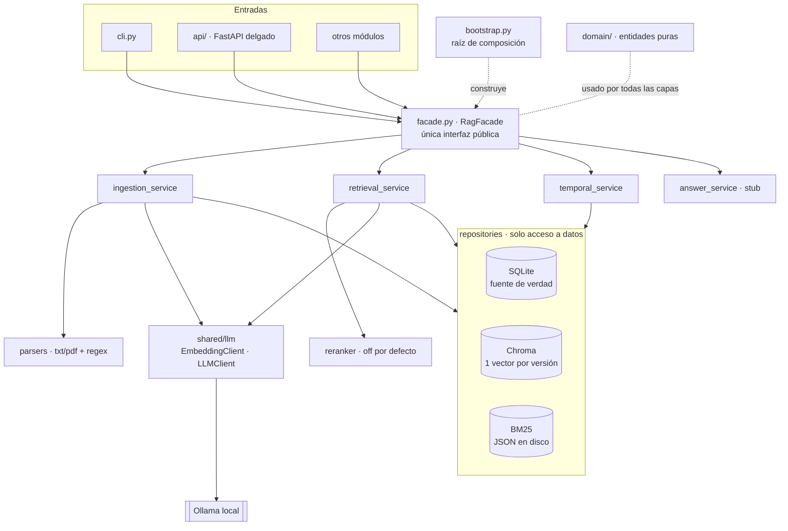

# Hackaton NTTDATA — RAG temporal sobre normativa SBS

Monorepo modular, 100 % local (Ollama, sin APIs externas). Módulos actuales: **`rag`** (abajo); **`audit`**, el auditor de respuestas expuesto como agente A2A ([modules/audit/README.md](modules/audit/README.md)), con su cliente y registro de agentes en `nanda/`; y **`compliance`**, que extrae obligaciones e infracciones LA/FT, calcula plazos y estima la exposición potencial ([modules/compliance/README.md](modules/compliance/README.md)).

> **Corpus normativo:** el corpus del repo **no garantiza estar completo**. El PDF de la Res. SBS 2660-2015 es un texto concordado que solo incluye hasta la Res. SBS 4705-2017; la Res. SBS 1743-2020 (que modifica el art. 49) todavía no está incorporada, y la SBS reporta versiones consolidadas posteriores. Los anexos de tipificación de la Res. SBS 2755-2018 no vienen en el PDF provisto. **La versión consolidada oficial vigente debe validarse contra el portal de la SBS.** Los PDFs se preparan con `python scripts/prepare_sbs.py` (ver [modules/compliance/README.md](modules/compliance/README.md)).

El módulo **`rag`** ofrece: búsqueda sobre normativa bancaria peruana (SBS) que

- **cita la fuente exacta** (norma, artículo, versión, intervalo de vigencia);
- sabe **qué texto estaba vigente en una fecha dada**;
- **avisa cuando un artículo fue modificado** y cuál es la versión vigente hoy.

Los demás módulos (orquestador, contradicciones, políticas internas, UI) se agregan en `modules/` y consumen `rag` **solo** a través de `RagFacade`.

---

## Cómo correr todo, paso a paso (Windows)

Los comandos son para **PowerShell** (o Anaconda Prompt) y se ejecutan **desde la carpeta raíz del repo**. Si usas Git Bash, cambia `Copy-Item` por `cp` y `curl.exe` por `curl`.

### 0. Requisitos (una sola vez)

| Herramienta | Para qué | Cómo obtenerla |
|---|---|---|
| Git | clonar el repo | https://git-scm.com |
| Anaconda o Miniconda | crear el entorno de Python 3.11 | https://www.anaconda.com/download |
| Ollama | correr los modelos en tu PC (LLM y embeddings) | https://ollama.com/download. Al instalarlo queda corriendo en segundo plano (ícono de la llama en la barra de tareas) |

GPU opcional. Los dos modelos caben en unos 5 GB de VRAM y sin GPU corren más lento.

### 1. Clonar y crear el entorno

```powershell
git clone https://github.com/CaVassM/Hackaton-NTTDATA.git
cd Hackaton-NTTDATA
conda create -n hackaton-ntt python=3.11 -y
conda activate hackaton-ntt
pip install -r requirements-dev.txt
```

> Si PowerShell responde `conda : no se reconoce...`, abre **Anaconda Prompt**, o ejecuta una vez `conda init powershell` y vuelve a abrir la terminal.

### 2. Descargar los modelos

```powershell
ollama pull qwen3.5:4b
ollama pull qwen3-embedding:0.6b-q8_0
ollama list            # deben aparecer los dos
```

### 3. Crear el archivo `.env`

**Qué es:** un archivo de texto con la configuración local (qué modelos usar, puertos y tokens de acceso entre agentes). El código lo lee al arrancar.

**Por qué no viene en el repo:** contiene **secretos** (los tokens), así que está en `.gitignore` y cada persona crea el suyo. En el repo solo está la plantilla **`.env.example`**, con todas las variables y valores por defecto.

**Cómo crearlo:**

```powershell
Copy-Item .env.example .env
```

Con eso ya tienes un `.env` que funciona. Lo único que conviene cambiar son los **tokens**, que son las contraseñas entre agentes:

1. Genera un token aleatorio:
   ```powershell
   python -c "import secrets; print(secrets.token_urlsafe(32))"
   ```
2. Abre `.env` (con VS Code, Bloc de notas, etc.) y pega **el mismo** token en estas dos líneas:
   ```ini
   A2A_AGENT_TOKENS={"copilot": "PEGA-AQUI-EL-TOKEN"}
   NANDA_AGENT_TOKEN=PEGA-AQUI-EL-TOKEN
   ```

Son dos líneas porque cada una la lee un lado distinto. `A2A_AGENT_TOKENS` la usa el **auditor**: es la lista de llaves que acepta y a qué agente pertenece cada una. `NANDA_AGENT_TOKEN` la usa el **copiloto**: es la llave que presenta al pedir una auditoría. Si no coinciden, el auditor responde **401**.

Qué significa cada variable:

| Variable | Valor por defecto | ¿Tocarla? |
|---|---|---|
| `OLLAMA_HOST` | `http://localhost:11434` | No, salvo que Ollama corra en otra máquina |
| `LLM_MODEL` / `EMBED_MODEL` | `qwen3.5:4b` / `qwen3-embedding:0.6b-q8_0` | No (si cambias `EMBED_MODEL`, vuelve a ingestar) |
| `LLM_THINK`, `LLM_TEMPERATURE`, `LLM_NUM_CTX` | `false`, `0.0`, `8192` | No |
| `RAG_RRF_K`, `RAG_CANDIDATES_K`, `USE_RERANKER` | `60`, `30`, `false` | No |
| `A2A_AGENT_TOKENS` | `{"copilot": "cambia-este-token"}` | **Sí**: pon tu token |
| `A2A_ALLOWED_AGENTS` | `["copilot"]` | No (agentes autorizados a pedir auditorías) |
| `A2A_PUBLIC_URL` | `http://localhost:8100` | Solo si cambias el puerto del auditor |
| `NANDA_AGENT_ID` / `NANDA_AGENT_TOKEN` | `copilot` / `cambia-este-token` | **Sí** el token: el mismo de arriba |

> Si no existe `.env`, todo usa los valores por defecto, salvo los tokens: quedan vacíos y el auditor rechaza todo con 401.
> El `.env` se lee **al arrancar**. Si lo editas, reinicia el servidor.

### 4. Cargar la normativa (ingesta)

```powershell
python -m modules.rag.cli ingest data/raw/sinteticos
python -m modules.rag.cli health            # "ok": true y 8 versiones en los índices
```

La ingesta lee las normas, guarda las versiones en `data/processed/` y calcula los embeddings con Ollama. Solo hay que repetirla si agregas normas.

### 5. Levantar los servicios (una terminal para cada uno)

En cada terminal nueva, primero `conda activate hackaton-ntt` y luego `cd` a la raíz del repo.

```powershell
# Terminal 1: auditor (agente A2A). Es el que usa el copiloto.
uvicorn modules.audit.api.app:app --port 8100

# Terminal 2 (opcional): API del RAG. Documentación interactiva en http://localhost:8000/docs
uvicorn modules.rag.api.app:app --port 8000
```

### 6. Probar que todo responde

Con el auditor corriendo (terminal 1), en otra terminal:

```powershell
# a) Agent Card (también puedes abrir esta URL en el navegador)
curl.exe http://localhost:8100/.well-known/agent-card.json

# b) Lo que hará el copiloto: pedir una auditoría con el cliente nanda (usa el .env)
python scripts/demo_audit_client.py
```

Lo esperado en (b): una respuesta correcta → `ALLOW`, y el caso demo de la UIF → `BLOCK`, con el motivo por afirmación. Para probar con curl, mira [modules/audit/README.md](modules/audit/README.md).

### 7. Correr los tests

```powershell
pytest -q            # no necesita los servidores levantados; con Ollama apagado, 3 tests se saltan
```

### Problemas frecuentes

| Síntoma | Causa y solución |
|---|---|
| `401` del auditor | Falta el token en `.env`, `A2A_AGENT_TOKENS` y `NANDA_AGENT_TOKEN` no coinciden, o no reiniciaste uvicorn después de editar `.env` |
| `403` del auditor | El agente no está en `A2A_ALLOWED_AGENTS` |
| `Ollama no esta corriendo` / `Failed to connect` | Abre la app de Ollama o ejecuta `ollama serve` |
| `"ok": false` en `health` con un modelo en `false` | Falta descargarlo: `ollama pull <modelo>` |
| El auditor dice que una versión no existe | No hiciste la ingesta (paso 4) |
| `400` al usar curl con tildes en el JSON | Manda el JSON desde un archivo: `--data-binary @archivo.json` |
| En PowerShell, `curl` se comporta raro | `curl` es un alias de `Invoke-WebRequest`; usa `curl.exe` |
| `address already in use` | El puerto está ocupado: usa otro con `--port`, y en el auditor también cambia `A2A_PUBLIC_URL` |

## Uso

Todos los comandos se ejecutan desde la raíz del repo.

### CLI

```bash
python -m modules.rag.cli ingest data/raw/sinteticos
python -m modules.rag.cli search "¿En cuántos días se responde un reclamo?" --fecha 2026-06-15
python -m modules.rag.cli search "plazo de reclamos"                  # sin fecha => hoy
python -m modules.rag.cli search "plazo de reclamos" --proyectos      # incluye proyectos, marcados
python -m modules.rag.cli vigente "Res. SBS 1234-2025" 2 --fecha 2026-07-01
python -m modules.rag.cli historial "Resolución SBS N° 1234-2025" 2
```

### API

```bash
uvicorn modules.rag.api.app:app --reload     # docs en http://localhost:8000/docs
```

El comando normal levanta el backend y publica temporalmente su API con Cloudflare Tunnel. Requiere `cloudflared` instalado:

```powershell
python scripts/start_backend.py
```

El script muestra la URL pública y la documentación en `/docs`. El Quick Tunnel dura mientras corre el script y se cierra con `Ctrl+C`; cualquier persona con la URL puede acceder a la API durante ese tiempo. Para dejar el backend solo en tu equipo, usa `python scripts/start_backend.py --no-cloudflare`.

| Método | Ruta | Qué hace |
|---|---|---|
| POST | `/rag/ingest` `{ruta?}` | Ingesta (solo rutas dentro de `data/raw`) |
| POST | `/rag/search` `{query, fecha?, top_k, incluir_proyectos}` | Búsqueda híbrida filtrada por vigencia |
| GET | `/rag/vigente?norma&articulo&fecha` | Texto vigente; `version: null` si no regía en esa fecha |
| GET | `/rag/historial?norma&articulo` | Todas las versiones de un artículo |
| GET | `/rag/cambios?norma` | Qué modificó la norma y qué le modificaron |
| GET | `/rag/version/{id}` · `/vigente?fecha` · `/posteriores` | Consultas por versión |
| GET | `/rag/health` | Ollama + conteo de índices |

### Frontend React

Con el backend iniciado en otra terminal, ejecuta:

```powershell
cd frontend
npm ci
npm run dev
```

Vite abre `http://localhost:5173` y reenvía `/api` al backend en `http://127.0.0.1:8000`. Para publicar el frontend en otro origen, configura `VITE_API_URL` con la URL del backend y agrega el origen del frontend a `FRONTEND_ALLOWED_ORIGINS` en `.env`.

### Desde otro módulo (la única forma permitida)

```python
from modules.rag import RagFacade

rag = RagFacade.from_settings()
res = rag.search("plazo para atender reclamos", fecha="2026-06-01")
for f in res.fragmentos:
    c = f.cita
    print(c.norma, c.articulo, c.version_id, c.fue_modificada, c.version_vigente_actual_id)

rag.get_version(2)               # texto + norma, artículo, desde, hasta, estado de la norma creadora
rag.vigente_en(2, "2026-07-01")  # False: ese día ya rige la versión nueva
rag.versiones_posteriores(2)     # [VersionDetalle(version_id=6, ...)]
```

Para montar la API en una app anfitriona: `from modules.rag import create_rag_router`.

> **Regla de frontera:** fuera de `modules/rag` solo se importa `modules.rag` (la fachada y las entidades exportadas). Lo verifica `test_ningun_otro_modulo_importa_internals_de_rag`.

---

## Diagrama de capas



Todas las dependencias se inyectan por constructor y los servicios dependen de interfaces (`SqlRepository`, `VectorRepository`, `LexicalRepository`, `EmbeddingClient`, `Reranker`). Solo `bootstrap.py` conoce las implementaciones concretas.

### Flujo de una búsqueda

```
pregunta ──embed_query──► Chroma (top-30) ─┐
        └──tokenize────► BM25   (top-30) ─┴─► RRF (k=60) ─► filtro de vigencia (SQL) ─► [reranker] ─► top_k + Cita
                                                               fecha ?? hoy
```

Solo se vectoriza la pregunta; los documentos se embeben durante la ingesta, que se hace offline. Si el filtro de fecha deja menos de `top_k` resultados, se amplía la búsqueda y se reintenta.

---

## Modelo de datos

```
norma(id, codigo UNIQUE, titulo, fecha_emision, tipo, estado ∈ {vigente, proyecto, derogada})
articulo(id, norma_id → norma, numero)                         UNIQUE(norma_id, numero)
version(id, articulo_id → articulo, texto, vigente_desde, vigente_hasta NULL = vigente,
        creada_por → norma, reemplaza_a → version)             a lo sumo 1 versión abierta por artículo
```

**Regla de vigencia:** `vigente_desde <= fecha < COALESCE(vigente_hasta, +∞)`. El límite `hasta` es **exclusivo**: el día en que entra en vigor la versión nueva, la anterior ya no rige. Además, una versión creada por una norma en estado `proyecto` **nunca** está vigente.

**Modificatorias:** el parser detecta `Modificar el artículo N … Resolución SBS N° X` y toma el texto nuevo citado entre comillas. La ingesta cierra la versión abierta (`vigente_hasta = vigencia de la modificatoria`), crea la nueva con `reemplaza_a` apuntando a la anterior y `creada_por = modificatoria`, y refresca los metadatos en Chroma. Un **proyecto** se guarda e indexa, pero nunca cierra versiones.

**`Cita`**: `norma, articulo, version_id, vigente_desde, vigente_hasta, fue_modificada, version_vigente_actual_id, score`, más `creada_por, reemplaza_a, es_proyecto`.
`fue_modificada` = existe una versión posterior. `version_vigente_actual_id` = la que rige **hoy**.

### Formato de entrada (`data/raw/**/*.txt|.pdf`)

```
CODIGO: Resolución SBS N° 567-2026
TITULO: ...
TIPO: resolucion
FECHA_EMISION: 2026-05-20
ESTADO: vigente            # vigente | proyecto | derogada
VIGENCIA_DESDE: 2026-07-01
---
Artículo 1.- Modificar el artículo 2 del ..., aprobado por Resolución SBS N° 1234-2025, ...:
“Artículo 2.- ... quince (15) días ...”
```

La cabecera es opcional. Sin ella (por ejemplo, en un PDF real), el código, la fecha ("Lima, 20 de mayo de 2026"), la vigencia ("entra en vigencia a partir del…" / "día siguiente") y el estado se deducen con heurísticas. Los códigos se normalizan: `Res. SBS N.° 01234-2025` ≡ `Resolución SBS N° 1234-2025`.

`data/raw/sinteticos/` (documentos **sintéticos**, no es normativa real):

1. Norma base `Resolución SBS N° 1234-2025`, con 3 artículos y vigente desde 2025-04-01.
2. Modificatoria `567-2026`: cambia el plazo del art. 2 de 30 a 15 días desde 2026-07-01.
3. Proyecto `PR-045-2026`, en consulta: propone 10 días y no se aplica.

---

## Configuración (`.env`)

| Variable | Default | Nota |
|---|---|---|
| `LLM_MODEL` | `qwen3.5:4b` | |
| `LLM_THINK` | `false` | Default global. Cada llamada puede cambiarlo: `llm.chat(..., think=True)` |
| `EMBED_MODEL` | `qwen3-embedding:0.6b-q8_0` | El índice queda atado al modelo: si lo cambias, vuelve a ingestar |
| `OLLAMA_HOST` / `OLLAMA_TIMEOUT_S` / `OLLAMA_MAX_RETRIES` | | Reintentos con backoff solo ante errores transitorios |
| `RAG_RRF_K` / `RAG_CANDIDATES_K` | `60` / `30` | |
| `USE_RERANKER` | `false` | `true` activa el reranker por LLM (una llamada por candidato) |
| `RAG_DIR` | `data/processed/rag` | SQLite, Chroma y BM25 |
| `LOG_DIR` | `data/processed/logs` | `rag_search.jsonl`: una línea por búsqueda (query, fecha, ids, tiempos) |

`shared/llm` queda listo para todo el proyecto:

- `LLMClient.generate / chat / chat_json(schema)`: la salida JSON se fuerza con un JSON schema o un modelo Pydantic.
- `EmbeddingClient.embed_documents / embed_query`: la consulta lleva la instrucción de qwen3-embedding; los documentos no.
- `check_ollama()`.

## Tests

```bash
pytest -q                 # 62 tests; los marcados 'ollama' se saltan si Ollama no responde
pytest -q -m "not ollama" # solo los que no requieren Ollama (usan un embedder falso determinista)
```

Cubren:

- La vigencia antes del cambio, el mismo día y después.
- Que la ingesta cierre la versión y enlace `reemplaza_a`.
- Que `search` con fecha filtre y marque `fue_modificada`.
- Que el proyecto no salga como vigente.
- Que la ingesta sea idempotente y que se repare un índice incompleto.
- La API, la frontera de imports y el healthcheck de Ollama.

## Estructura

```
shared/      config/ (settings base) · llm/ (interfaces + Ollama + healthcheck) · logging/ (texto + JSONL)
modules/rag/ config · domain/ · repositories/ · services/ · api/ · facade · bootstrap · cli · tests/
data/        raw/ (fuentes versionadas) · processed/ (generado, ignorado por git)
```
