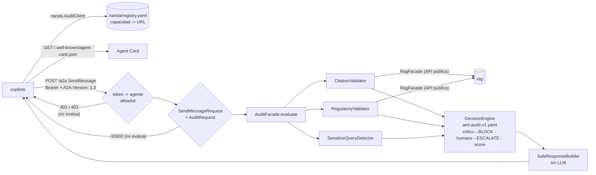

# Auditor normativo AML (agente A2A)

Servicio de aseguramiento que decide si una respuesta candidata de un copiloto normativo/AML se puede publicar: **ALLOW | WARN | BLOCK | ESCALATE**. Audita **afirmación por afirmación** con controles deterministas sobre la normativa del módulo `rag`. Se expone como agente **A2A 1.0**, y el copiloto le habla mediante `nanda/client.py`.



## Levantarlo

```bash
# .env (o variables de entorno). Sin tokens, todo se rechaza con 401.
A2A_AGENT_TOKENS={"copilot": "cambia-este-token"}
A2A_ALLOWED_AGENTS=["copilot"]
A2A_PUBLIC_URL=http://localhost:8100

python -m modules.rag.cli ingest data/raw/sinteticos     # el auditor verifica contra estos índices
uvicorn modules.audit.api.app:app --port 8100
```

## Ejemplo con curl

```bash
curl -s localhost:8100/.well-known/agent-card.json      # descubrimiento (público)

curl -s -X POST localhost:8100/a2a \
  -H "Authorization: Bearer cambia-este-token" \
  -H "A2A-Version: 1.0" -H "Content-Type: application/json" \
  --data-binary @modules/audit/examples/send_message_demo.json
```

El caso demo ("…reportarse a la UIF dentro de **24 horas** porque supera S/ 50,000…") devuelve `BLOCK`. La afirmación `c1` es crítica: la cifra "24 horas" no aparece en la evidencia citada. `c2` (dato del caso) y `c3` (inferencia) quedan pendientes de verificación, y además se detecta el tema sensible UIF. El `AuditResult` viaja en el `DataPart` de la respuesta.

En Git Bash para Windows usa `--data-binary @archivo`: si pasas el JSON en línea con `-d '...'`, las tildes se envían mal y el servidor responde 400.

Desde otro agente:

```python
from nanda import AuditClient
result = AuditClient.from_env().request_audit(audit_request)  # NANDA_AGENT_TOKEN en el entorno
```

## Errores (todos se devuelven **antes** de evaluar)

| Caso | Respuesta |
|---|---|
| Sin token o token desconocido | HTTP 401 + `WWW-Authenticate: Bearer` |
| Agente autenticado pero fuera de `A2A_ALLOWED_AGENTS` | HTTP 403 |
| `A2A-Version` distinta de 1.0 | JSON-RPC `-32009` |
| Cuerpo que no es JSON / sobre JSON-RPC inválido / método distinto de `SendMessage` | `-32700` / `-32600` / `-32601` |
| `params` que no cumplen `SendMessageRequest`, o `DataPart` que no es un `AuditRequest` válido | `-32602` (con detalle de validación) |

## Tests

```bash
pytest -q modules/audit nanda
```

- **T1:** la Agent Card está en la ruta well-known, valida contra el esquema del SDK y anuncia `audit_candidate_response`.
- **T2:** con token válido y agente permitido se llama a `evaluate()` y la respuesta llega como `SendMessageResponse` parseable.
- **T4:** sin token o con token inválido responde 401 y no evalúa.
- **T6:** un agente fuera de la allowlist recibe 403 y no evalúa.
- **T7:** 13 variantes de esquema inválido devuelven error y no evalúan.

Un `SpyFacade` comprueba que `evaluate()` no se llama en los rechazos. Hay además tests del núcleo (casos a–f y el demo), del registro y del cliente de punta a punta.

## Decisiones y limitaciones

- **A2A verificado, no asumido:** la ruta de la Agent Card (`/.well-known/agent-card.json`), el header `A2A-Version`, el método `SendMessage` y los códigos de error salen de `a2a-sdk==1.2.2` (protocolo 1.0). La card se construye con sus tipos protobuf.
- **Servidor JSON-RPC propio, no el del SDK:** `a2a-sdk[http-server]` exige Starlette 1.x, incompatible con el `fastapi==0.115.6` fijado. Solo se implementa `SendMessage` síncrono: sin tasks, streaming ni push notifications. El formato coincide con el que envía y espera el cliente JSON-RPC oficial del SDK.
- **Autenticación local simple:** son bearer tokens estáticos por agente en `.env`. No hay rotación, expiración, mTLS ni firma de la Agent Card. La card es pública.
- **Núcleo mínimo:** solo validadores deterministas (cita, vigencia, temas sensibles). Aún no hay groundedness por LLM, `AccessValidator` por rol/clasificación ni persistencia.
- **`dato_caso` e `inferencia`:** sin evidencia normativa quedan como `WARN` (pendientes), nunca como `PASS`. La detección de cifras cubre montos `S/` y `US$`, plazos en horas/días/meses/años y fechas; números escritos solo en palabras no se detectan.
- **Fallo cerrado:** si un validador lanza una excepción, se registra como hallazgo crítico y la decisión es `BLOCK`.

## Roadmap

1. `GroundednessValidator` por LLM (`chat_json`, `think=false`, un reintento y luego INSUFICIENTE), solo sobre afirmaciones que ya pasaron los controles deterministas.
2. `AccessValidator` por rol y clasificación, más `allowed_filter(role)` para filtrar antes de recuperar.
3. Persistencia en SQLite (`audit_interaction`, `claim_validation`, `human_review`…) con cadena de hashes `audit_event` y `verify_chain()`. Endpoints `GET /audit/{id}` y `POST /audit/{id}/review`.
4. `data/eval/audit_cases.jsonl` + `scripts/eval_audit.py` (aciertos, falsos negativos y falsos positivos).
5. NANDA Town, escenarios YAML, tests T3, T5 y T8–T12, registro en índices públicos, mTLS, Agent Card firmada, OPA, Keycloak, OpenTelemetry, dashboards, privacidad y sesgo.
