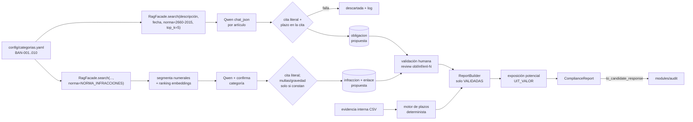

# Compliance LA/FT (obligaciones, plazos y exposición potencial)

A partir de las normas ya ingeridas en el RAG, este módulo:

- extrae obligaciones LA/FT (Res. SBS 2660-2015) e infracciones;
- calcula atrasos contra la evidencia interna;
- estima la **exposición potencial, no la sanción determinada**.

**No inventa datos.** Todo lo que propone el LLM pasa un verificador determinista y luego una **validación humana**. Los cálculos solo usan filas validadas.



## Correrlo

```powershell
python scripts/prepare_sbs.py                          # PDFs SBS -> data/raw/sbs_txt (limpios, con cabecera)
python -m modules.rag.cli ingest data/raw/sbs_txt
python -m modules.rag.cli ingest data/raw/sinteticos   # incluye el anexo SINTÉTICO de infracciones

# 1. Extracción offline (LLM). Reanudable: lo ya hecho sale de la caché.
python -m modules.compliance.cli extract-obligations --categorias BAN-004,BAN-005,BAN-007
python -m modules.compliance.cli extract-obligations                 # todas, por prioridad
$env:NORMA_INFRACCIONES="SINTETICO-ANEXO-INFRACCIONES-LAFT"          # ver "Infracciones"
python -m modules.compliance.cli extract-infractions --categorias BAN-004,BAN-005,BAN-007

# 2. Validación humana (queda quién y cuándo en la fila y en revision_log)
python -m modules.compliance.cli proposals                           # propuestas con su cita
python -m modules.compliance.cli review obl-5 --revisor "tu.nombre" --aprobar
python -m modules.compliance.cli review obl-34 --revisor "tu.nombre" --rechazar --comentario "corredores de seguros"

# 3. Reporte (solo validadas), opcionalmente auditado por modules/audit
python -m modules.compliance.cli report --fecha-corte 2026-10-17 --auditar
```

Para correr la extracción en segundo plano, lanza el comando en otra terminal (deja log JSONL en `data/processed/logs/compliance_extraction.jsonl`), o usa la API:

```powershell
uvicorn modules.compliance.api.app:app --port 8200   # docs: http://localhost:8200/docs
```

| Método | Ruta | Qué hace |
|---|---|---|
| POST | `/compliance/extract` `{tipo, categorias?, fecha?}` | Lanza la extracción en background (202 + `job_id`) |
| GET | `/compliance/extract/{job_id}` | Estado y progreso del job |
| GET | `/compliance/proposals?tipo=obl\|inf\|enl&estado=` | Propuestas con su cita |
| POST | `/compliance/proposals/{obl-N\|inf-N\|enl-N}/review` `{aprobar, revisor, comentario?}` | Validar o rechazar |
| POST | `/compliance/report` `{fecha_corte?, categorias?, auditar}` | `ComplianceReport` (+ `AuditResult`) |

## Demo (BAN-004 ROS, BAN-005 registro, BAN-007 capacitación)

En la base generada en esta sesión, las propuestas recomendadas para validar son:

| Categoría | Propuesta | Norma / artículo / versión | Plazo verificado en la cita |
|---|---|---|---|
| BAN-004 ROS | `obl-5` + `inf-1` + `enl-1` | 2660-2015 art. 58 (v69) | "veinticuatro horas (24)" desde la calificación como sospechosa |
| BAN-005 registro | `obl-8` + `inf-4` + `enl-4` | 2660-2015 art. 54 (v65) | copia de seguridad a disposición de la SBS en "cuarenta y ocho (48) horas" de requerida |
| BAN-007 capacitación | `obl-28` + `inf-6` + `enl-7` | 2660-2015 art. 41 (v49) | capacitación de nuevos ingresos en 30 días |
| rechazar | `obl-34` | art. 65 (corredores de seguros) | el LLM leyó "dos (2) capacitaciones al año" como un plazo de 2 años |

Los ids dependen de la corrida: confírmalos con `proposals`. Resultado verificado sobre una copia de la base, con corte al 2026-10-17:

- **BAN-004:** atrasado, 4 días máximo. Expuesto a la infracción sintética 3.1, de 80 a 150 UIT. La auditoría da **ESCALATE** porque el ROS es un tema que la IA no decide.
- **BAN-005:** atrasado, 2 días. Infracción 2.2, de 30 a 70 UIT.
- **BAN-007:** atrasado, 31 días. Infracción 2.1, de 20 a 50 UIT.
- BAN-005 y BAN-007 juntos dan **WARN** en la auditoría.

`obl-34` muestra para qué sirve la validación humana: una cita literal y con el número correcto puede estar mal interpretada.

## Reglas deterministas (el LLM nunca tiene la última palabra)

- **Cita literal:** la `cita_textual` debe existir tal cual en el texto de la versión, normalizando solo espacios. Si no, la propuesta se descarta y queda en el log.
- **Plazo dentro de la cita:** si `plazo_valor` no es null, ese número debe aparecer en la cita, en cifras o en palabras. Si no, se descarta.
- **Multas:** solo se aceptan si su número aparece en la cita; si no, quedan en null. Con "hasta N UIT" no hay mínimo.
- **Gravedad:** solo se acepta si consta en la cita o en el encabezado del artículo.
- **Periodicidad sin número** ("al año"): equivale a 1 año solo si la cita lo dice literalmente.
- **Unidad `horas`:** se agregó al esquema porque el ROS fija 24 horas. La evidencia trae fechas, no horas, así que 24 horas cuentan como 1 día. La granularidad es de día.
- **Días hábiles:** se cuentan desde el día hábil siguiente al evento, sin fines de semana ni feriados. [`data/raw/compliance/feriados.csv`](../../data/raw/compliance/feriados.csv) es una lista **de ejemplo**: verifícala.
- **Exposición:** hay monto solo si la infracción **validada** tiene multa en su cita y `UIT_VALOR` está en `.env`. Sin multa en la cita se muestra "monto no determinado". `UIT_VALOR` **no tiene valor por defecto** a propósito: si falta, el rango se muestra solo en UIT.
- **Rótulo:** cada reporte dice "exposición potencial, no sanción determinada".

## Evidencia interna

El formato acordado está en [`data/raw/compliance/README.md`](../../data/raw/compliance/README.md): `obligacion_codigo, sujeto_id, fecha_evento, fecha_cumplimiento, fecha_corte`.

## Auditoría del reporte

`report.to_candidate_response()` genera afirmaciones así:

- `normativa` para cada cita, con `evidence_ids = version_id`;
- `dato_caso` para cada fila de evidencia;
- `inferencia` para la exposición.

Desde la política `aml-audit-v2`, el techo `exposicion_potencial` fija la decisión máxima en **WARN** cuando el candidato tiene afirmaciones `dato_caso` o el `use_case` es de compliance (`reporte_cumplimiento`). Un reporte de compliance **nunca sale ALLOW**. El techo solo restringe: todo lo que menciona ROS o UIF sigue saliendo **ESCALATE**, y un hallazgo crítico sigue dando **BLOCK**.

## Limitaciones

- **Infracciones:** el PDF de la 2755-2018 trae solo el cuerpo del reglamento. Su Art. 5 remite a los anexos de tipificación, que no se entregaron, y no menciona ningún monto en UIT. Para la demo se usa un **anexo SINTÉTICO** con código propio, `SINTETICO-ANEXO-INFRACCIONES-LAFT`, en `data/raw/sinteticos/`. El filtro `norma=2755-2018` nunca lo devuelve, el reporte lo marca `[SINTETICA]` y agrega una advertencia. Con los anexos reales: déjalos en `data/raw/sbs/`, agrégalos a `scripts/prepare_sbs.py`, ingiérelos y usa `NORMA_INFRACCIONES` con su código.
- **Res. SBS 1743-2020** (modifica el art. 49): **pendiente**, porque el texto no llegó al repo. Para incorporarla:
  1. Agrega una `Fuente` en `scripts/prepare_sbs.py` con cabecera `CODIGO: Resolución SBS N° 1743-2020`, `VIGENCIA_DESDE` y el artículo "Modificar el artículo 49 … Resolución SBS N° 2660-2015 … “Artículo 49.- …”".
  2. Ingiérela. Rag cierra la versión vigente del art. 49 y crea la nueva.
  3. Vuelve a correr `extract-obligations --categorias BAN-005`. La caché va por `version_id`, así que solo se recalcula lo nuevo.
- **Cobertura de la búsqueda:** recupera los 5 artículos más cercanos por categoría. Algunos relevantes quedan fuera; por ejemplo, el art. 40 (capacitaciones del oficial) no entró en BAN-007. Puedes subir `EXTRACTION_TOP_K` o afinar la `descripcion_busqueda`.
- El enlace de respaldo por embeddings top-3 entre obligación e infracción no se implementó, porque no sobró tiempo.
